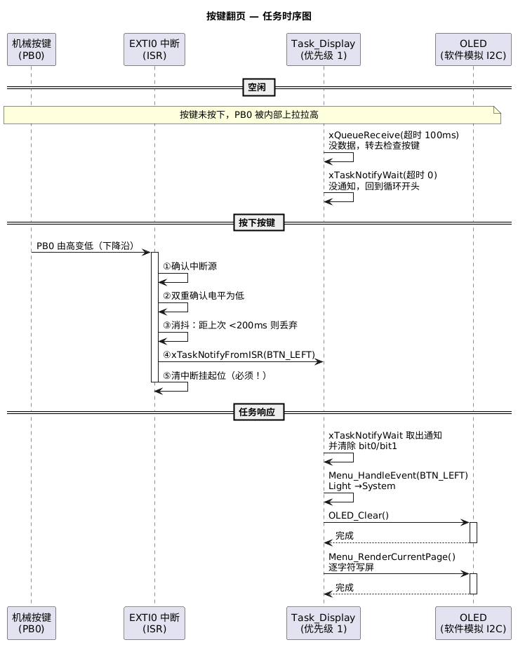
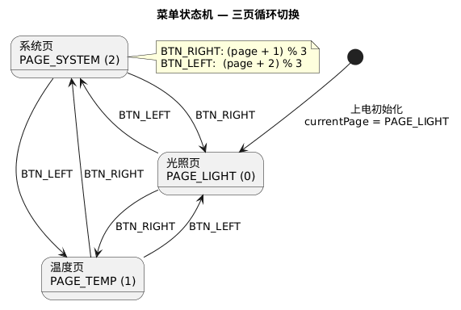
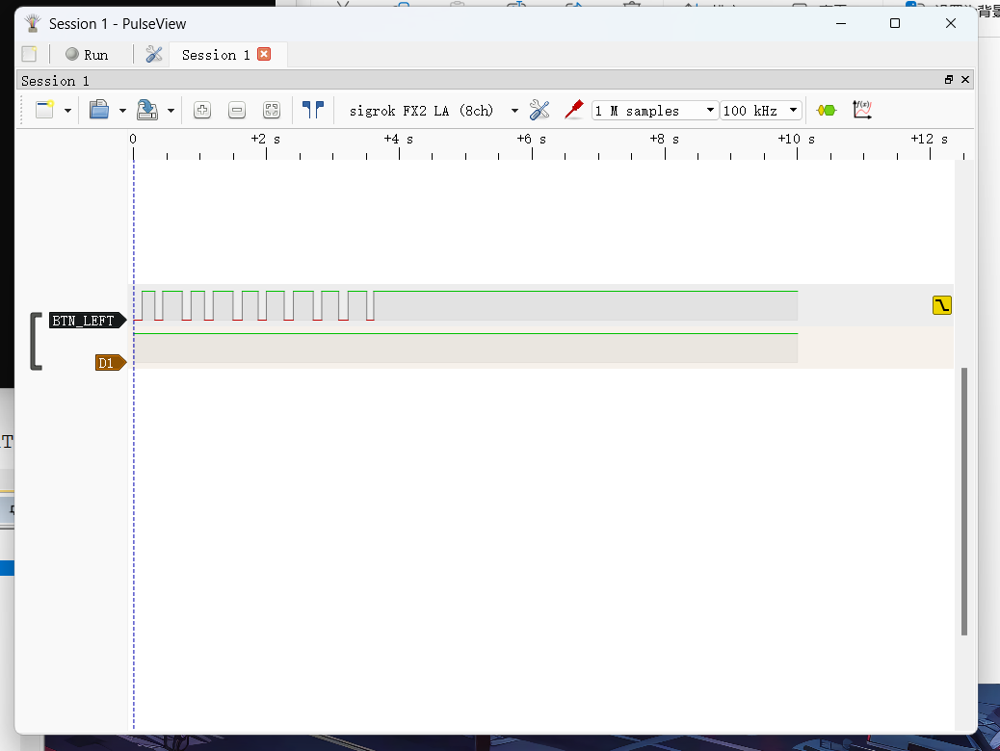
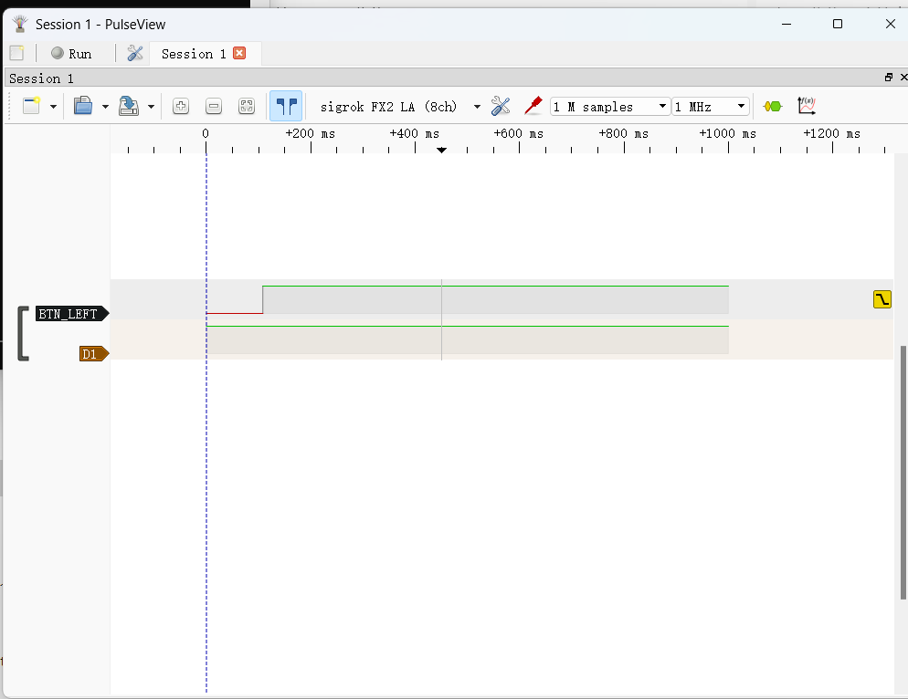
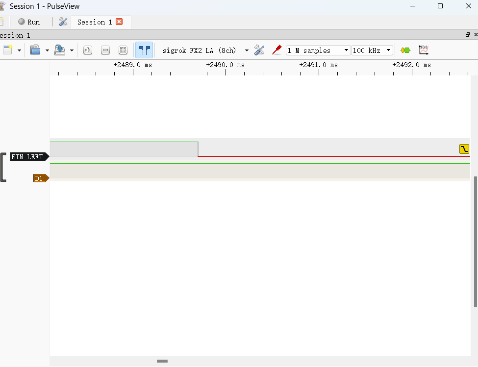
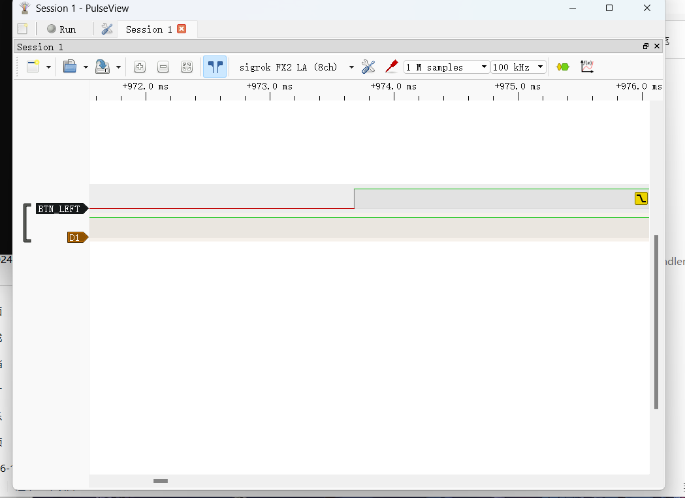

# STM32 智能天气站（FreeRTOS + Modbus + PID）

基于 STM32F103C8T6 的嵌入式学习项目，覆盖 RTOS 多任务、ADC+DMA、OLED、按键菜单、Modbus RTU 和电机 PID 闭环。

## 功能清单

| 模块 | 实现 | 关键点 |
|---|---|---|
| 传感器采集 | 光敏（PA0）+ NTC（PA1），ADC + DMA 双通道 | CPU 不参与搬运；200ms 周期 |
| 显示 | 0.96" OLED（SSD1306） | **GPIO 软件模拟 I2C**（PB8/PB9），非硬件 I2C 外设 |
| 人机交互 | EXTI 按键（PB0/PB1）+ 三页菜单 | 任务通知唤醒，菜单状态机 |
| 通信 | USART1 printf + **Modbus RTU 从机**（USART2） | DMA 接收 + IDLE 分帧 + CRC16；功能码 03/06 |
| 电机控制 | TB6612FNG + JGA25-370 编码器电机 | TIM1_CH1/PA8 20kHz PWM；TIM3 编码器 4 倍频 |
| 闭环调速 | 前馈 + PID | 编码器实测 408.5 计数/圈；20/50/80% 正反转稳定 |

## 系统架构

```text
[光敏 PA0] ─┐
            ├─ ADC + DMA ─> Task_Sensor(200ms) ─> xDisplayQueue ─> Task_Display ─> OLED
[NTC  PA1] ─┘                                └─> xCommQueue    ─> Task_Comm    ─> USART1 printf

[PC] <─ USART2 / Modbus RTU ─> Task_Display(Modbus_Poll) <─> regTable[0..5]

[PC] ─ 0x0005 目标速度 ─> regTable[5] ─> Task_Motor(20ms) ─> TB6612 ─> 电机
电机编码器 A/B ─> PA6/PA7 ─> TIM3 ─> Encoder_GetRPM ─> Task_Motor(前馈 + PID)
```

- `Task_Sensor`：优先级 3，200ms；ADC+DMA 采样，更新 Modbus 寄存器 0~2，写显示/通信队列。
- `Task_Display`：优先级 1；OLED 刷新、菜单、`Modbus_Poll()`、按键任务通知。
- `Task_Comm`：优先级 2；USART1 每秒打印光照/NTC。
- `Task_Motor`：优先级 2，20ms；读 0x0005，编码器测速，前馈 + PID，驱动 TB6612。
- 队列深度 1，使用 `xQueueOverwrite` 保留最新值；按键用任务通知，不额外占队列。

## 硬件清单

- MCU：STM32F103C8T6 最小系统板
- 传感器：光敏电阻模块（AO）、NTC 热敏电阻模块（AO）
- 显示：0.96" OLED，SSD1306，I2C
- 按键：2 个，PB0/PB1，EXTI
- 电机驱动：TB6612FNG
- 电机：JGA25-370，6V，9.6:1，带霍尔编码器
- 调试：ST-Link V2、USB-TTL（CH340）
- 分析：NanoDLA 逻辑分析仪（8 通道 / 24MHz）+ 万用表
- 电源：5V USB-TTL 供 TB6612 VM；4 节 AA 电池盒备用（电压待确认，尚未用于电机测试）
- 面包板、杜邦线

## Modbus 寄存器

USART2：PA2/PA3，115200 8N1，从机地址 1，功能码 03（读）/ 06（写）。

| 地址 | 内容 | 读写 | 说明 |
|---:|---|---|---|
| 0 | 光照电压 | R | 单位 mV；注意做了 `4096 - raw` 取反 |
| 1 | NTC 电压 | R | 单位 mV；同样取反 |
| 2 | 运行秒数 | R | `xTaskGetTickCount() / 1000` |
| 3 | 从机地址 | R | 固定 1 |
| 4 | 光照阈值 | R/W | 默认 800 |
| 5 | 目标速度 | R/W | -100~100，对应 -425~425 RPM（5V） |

> **取反说明**：传感器读数做了 `4096 - raw`，所以显示的 "mV" = `3300 - 引脚实际电压`，不是引脚电压本身。

验证工具：`pymodbus 3.16.1`，脚本见 `test/`。运行前关闭占用 COM9 的串口助手。

## 电机 PID 闭环

- PWM：TIM1_CH1 / PA8，20kHz（PSC=35，ARR=99）
- 方向：AIN1=PA4，AIN2=PA5；STBY 接高
- 编码器：TIM3_CH1/CH2（PA6/PA7），`TIM_EncoderMode_TI12` 四倍频
- 实测计数：**408.5 计数/输出轴一圈**（10 圈 4085，20 圈 8172；理论 422.4，实测低约 3.3%）
- 测速：`RPM = Δcounts × 60 / (408.5 × dt)`
- `MOTOR_MAX_RPM = 425.0f`（5V 实测 100% 空载）
- 控制：`dt = 20ms`，`Kp=0.1`、`Ki=0.05`、`Kd=0`、死区 8 RPM
- 前馈：`u = percent + PID 修正`，最终限幅 -100~100

### 实测结果（5V，空载）

| 目标 | 目标 RPM | 实测 RPM | 结论 |
|---:|---:|---|---|
| 20% | 85 | 80~88 | 稳定 |
| 50% | 212 | 212~227 | 稳定，约 +8 RPM |
| 80% | 340 | 330~345 | 稳定 |
| 100% | 425 | 411→455→440 | 饱和边界，10s 未完全收敛 |
| -20% | -85 | -73~-88 | 稳定，方向正确 |

完整数据：[`test/w2.5-step4-pid/closed-loop-log.md`](test/w2.5-step4-pid/closed-loop-log.md)

## 系统设计图

用时序图和状态机图描述运行时行为（源文件为 PlantUML，见 [`docs/diagrams/`](docs/diagrams/)）。

### 任务时序图 —— 一次按键的完整链路



### 菜单状态机 —— 三页循环切换



> 完整说明与修改方法见 [`docs/diagrams/README.md`](docs/diagrams/README.md)

## 调试记录

### 按键抖动实测（逻辑分析仪）

**背景**：按键消抖窗口从 20ms 改到 200ms，解决了「按一次跳两页」的问题。但「根因是抖动」这个结论当时只是推断，没有仪器证据。

**验证方法**：用 NanoDLA 探 PB0 原始波形，100kHz / 1MHz 两档采样，多个时间尺度交叉验证。

**结果**：15 次按压，零异常——按下与松开边沿都干净，没有可见抖动。

**结论**：问题修好了，但根因**没有坐实**。

> 教训：「修好了」≠「知道为什么修好了」。正确顺序是先取证、再改代码。

| 10 秒内 10 次按键，全部干净 | 单次完整按键（1 秒窗口） |
|:---:|:---:|
|  |  |

| 按下边沿放大（µs 级） | 松开边沿放大 |
|:---:|:---:|
|  |  |

> 完整的测量方法、参数与复现步骤见 [`docs/waveforms/README.md`](docs/waveforms/README.md)

## 构建与运行

1. Keil MDK 打开 `project.uvprojx`；
2. Build，ST-Link 下载；
3. USART1（PA9/PA10）115200 用于 printf；
4. USART2（PA2/PA3）115200 用于 Modbus；
5. Python 环境安装 `pymodbus==3.16.1`，运行 `test/` 下的脚本（默认 COM9，按实际修改）。

## 已知限制

- 100% 占空比是饱和边界，不建议用于精确调速；精确调速用 20~80%。
- 当前只在 **5V** 下验证；换 6V 电池后需重新测最大转速并更新 `MOTOR_MAX_RPM`。
- EC11 菜单暂时停用，TIM3 已让给电机编码器；待迁到 EXTI/轮询。
- 光敏电阻需要机械固定；电机振动会导致读数跳变（固定后解决）。
- W25Q64 SPI Flash、LVGL、MQTT、Linux 交叉编译尚未实现，不在本仓库中。
- 传感器电压做了取反，显示的 mV 不是引脚实际电压。

## 目录结构

```text
STM32_Weather_Station/
├─ Hardware/     AD、OLED、Serial、Button、Menu、Modbus、Motor、PWM、Encoder、PID
├─ user/         main.c（任务与初始化）、stm32f10x_it.c（中断）
├─ system/       Delay、Sys
├─ FreeRTOS/     FreeRTOS 内核与配置
├─ library/      STM32 标准外设库
├─ start/        启动文件
├─ docs/         diagrams/ 时序图、状态机图；waveforms/ 逻辑分析仪波形
└─ test/         W2.5 各阶段测试脚本与日志
```

## 相关文档

- [`docs/diagrams/README.md`](docs/diagrams/README.md) —— 时序图/状态机图说明
- [`docs/waveforms/README.md`](docs/waveforms/README.md) —— 逻辑分析仪测量方法与复现
- [`test/w2.5-step4-pid/closed-loop-log.md`](test/w2.5-step4-pid/closed-loop-log.md) —— PID 闭环原始数据与结论
- [`test/w2.5-step3-motor-task/motor-task-log.md`](test/w2.5-step3-motor-task/motor-task-log.md) —— Modbus 目标转速验证
- [`test/w2.5-step2-ec11/ec11-count-log.md`](test/w2.5-step2-ec11/ec11-count-log.md) —— EC11 计数与菜单验证
- [`test/w2.5-step1/open-loop-log.md`](test/w2.5-step1/open-loop-log.md) —— 电机开环 PWM 验证
