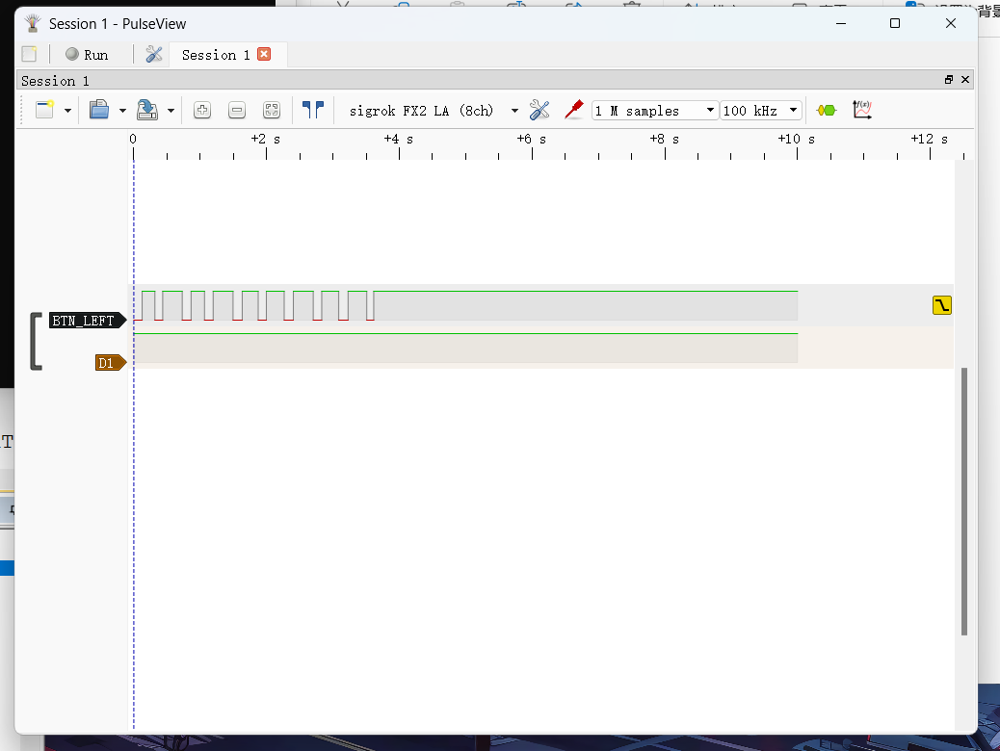
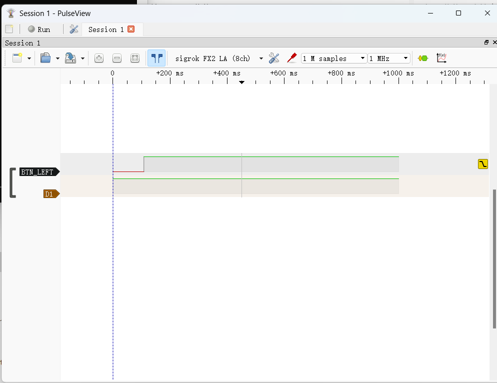
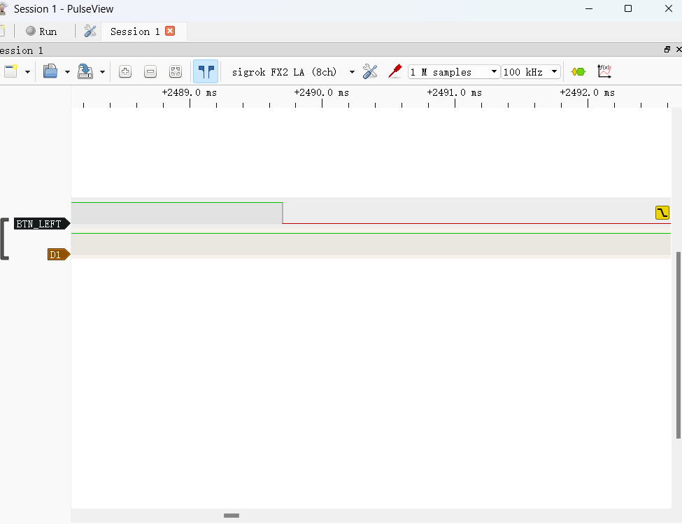
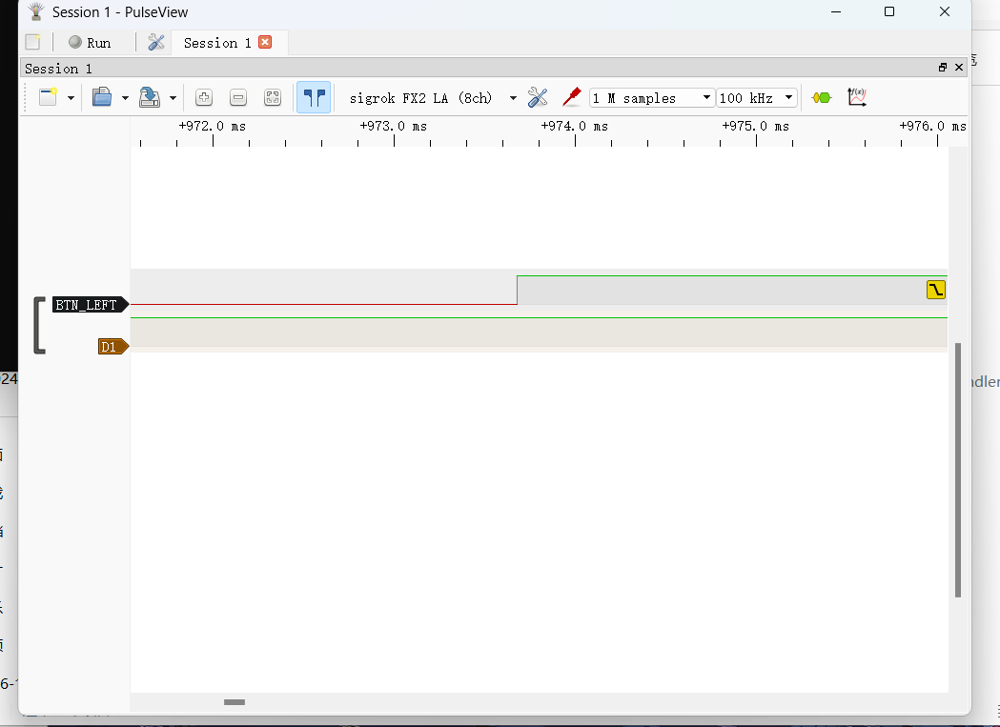

# STM32 Weather Station (基于 FreeRTOS 的桌面气象站)

## 📖 项目简介
本项目基于 STM32F103C8T6 微控制器，搭载 FreeRTOS 实时操作系统，实现了对环境光照强度与温度的实时采集、OLED 屏幕实时显示以及串口数据交互。项目采用模块化编程思想，具备良好的实时性、稳定性和可扩展性。

## 🔌 硬件清单
- MCU: STM32F103C8T6 最小系统板
- 传感器: 光敏传感器模块 (AO 输出)
- 传感器: NTC 热敏电阻模块 (AO 输出)
- 显示模块: 0.96寸 OLED 屏幕 (I2C接口)
- 调试工具: ST-Link V2、USB转TTL模块
- 面包板及杜邦线若干

## 📐 系统架构 (数据流图)
```text
  [传感器层]
  光敏传感器 (PA0) ──┐
                     ├──> [ADC + DMA 自动扫描]
  NTC 传感器 (PA1) ──┘
                            │
                            ▼
                    [Task_Sensor 任务]
                     (周期: 200ms)
                            │
                            ▼ (xQueueOverwrite)
                ┌───────────┴───────────┐
                ▼                       ▼
       [xDisplayQueue]          [xCommQueue]
        (深度:1, 最新值)         (深度:1, 最新值)
                │                       │
                ▼                       ▼
       [Task_Display]           [Task_Comm]
      (I2C OLED 刷新)          (UART 串口打印)
```

## 🔬 调试记录

### 按键抖动实测（逻辑分析仪）

**背景**：按键消抖窗口从 20ms 改到 200ms，解决了「按一次跳两页」的问题。但「根因是抖动」这个结论当时**只是推断**——代码层面拿不出 20ms 那版的证据，也没用仪器抓过波形。

**验证方法**：用逻辑分析仪（NanoDLA）探 **PB0 引脚的原始波形**。按键消抖是纯软件的时间判断，不改变引脚电平，所以探针能看到最真实的信号。100kHz / 1MHz 两档采样，多个时间尺度交叉验证。

**结果**：**15 次按压，零异常**——按下与松开的边沿都干净，没有可见抖动。

**结论**：问题修好了，但根因**没有坐实**。

> 这本身就是个教训：**「修好了」≠「知道为什么修好了」**。
> 当时的做法是先改代码、问题消失、就当成了结论；正确的顺序应该是**先取证，再改代码**。

| 10 秒内 10 次按键，全部干净 | 单次完整按键（1 秒窗口） |
|:---:|:---:|
|  |  |

| 按下边沿放大（µs 级） | 松开边沿放大 |
|:---:|:---:|
|  |  |

> 完整的测量方法、参数与复现步骤见 [`docs/waveforms/README.md`](docs/waveforms/README.md)
